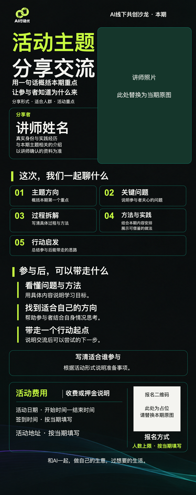

# AI行动π沙龙海报 Skill

为 Codex 提供可复用的 AI行动π活动海报制作流程，覆盖资料整理、人物与背景融合、真实字体排版、高清长图、朋友圈拆图和二维码核对。

默认输出宽 2160 像素的 PNG 长图，以及通常两张 2160×2880 的朋友圈短图。可以按活动内容调整尺寸和张数。



示例使用照片与二维码占位区。实际制作时填写当期活动资料，并使用讲师照片和本期报名码。

## 安装

将仓库放入 Codex 的 skills 目录。

```sh
git clone https://github.com/alex584221185-wq/ai-action-pi-poster.git ~/.codex/skills/ai-action-pi-poster
```

在新的 Codex 聊天中使用 `$ai-action-pi-poster`，或者说“用AI行动π海报Skill制作下一期沙龙海报”。

## 提供哪些材料

- 期数、主题、分享重点和适合人群。
- 讲师姓名、简短真实介绍和清晰原照片。
- 完整日期、开始结束时间、签到时间与展示地址。
- 费用或押金及退还规则、人数上限。
- 本期报名二维码原图或链接。
- 有需要时提供特殊风格、指定措辞、输出尺寸与张数。

品牌 Logo、流线背景和可编辑基础版式已经包含在仓库中。可以直接复制 [材料填写模板](references/brief.md)。

## 使用示例

```text
用 $ai-action-pi-poster 制作AI行动π下一期沙龙海报。
主题、讲师照片和报名信息见附件。
请先核对必要资料，再输出高清长图和朋友圈短图。
```

## 工具与运行条件

- Skill 说明可以由 Codex 读取。
- 真实字体排版、裁切与本地验收工具使用 macOS 的 AppKit、CoreText 和 Vision，需要可用的 Swift 工具链。
- 背景生成或人物背景融合需要支持相应图片能力的 Codex 环境。已经合适的素材可以直接合成。
- 苹方使用本机已安装字体，仓库不分发字体文件。

```sh
swift ~/.codex/skills/ai-action-pi-poster/scripts/poster.swift render design.json
swift ~/.codex/skills/ai-action-pi-poster/scripts/poster.swift split split.json
swift ~/.codex/skills/ai-action-pi-poster/scripts/poster.swift inspect poster.png inspection.json qr.png
```

配置格式见 [工具用法](references/tools.md)，制作细节见 [视觉与排版](references/production.md)，Skill 入口为 [SKILL.md](SKILL.md)。

文字清晰度以原尺寸检查为准。照片细节取决于原素材。二维码比对检查图案内容，报名入口可用性需要实际打开或微信实扫。
